<div align="center">

# GestureOS

**Control a Windows PC with your bare hands, through a webcam.**
Move the cursor, click, scroll, switch windows, control media, launch apps and draw in the air.


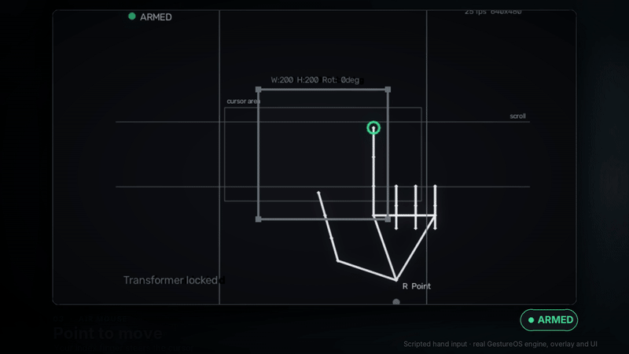

<sub>Rendered from the real application with **scripted hand landmarks** (no webcam recording): real engine, controllers, overlay and UI; OS input is faked so nothing moved a real cursor. [Watch the full film with sound](docs/media/demo.mp4).</sub>

</div>

---

## What it is

GestureOS turns a normal webcam into an input device. A hand-landmark model finds 21 points on each hand in every frame; geometry on those points decides which gesture you are making; a controller per feature turns it into real mouse and keyboard events. A dark, monochrome desktop window ("Flight Recorder") shows exactly what the system sees and what it just did, so you are never guessing.

I built it to answer one question: *can hand gestures be made safe and predictable enough to use on a real desktop?* Most of the engineering effort therefore went into **not doing things by accident**, not into adding gestures.

## Highlights

- **Safe by default.** It starts *disarmed*: it watches but sends nothing. You arm it with a switch or by holding both open palms for about a second. **Ctrl+Alt+F12 disarms from any window.** [Safety model](docs/SAFETY.md)
- **Works at any hand angle and distance.** Gestures are decided from distances between landmarks, scaled by hand size, not from pixel positions, so rotating your hand or moving closer does not break them.
- **Nine controls** (mouse, scroll, window switch, canvas, media, launcher, Ctrl hold, quit, arm), split between hands so they rarely conflict (table below).
- **You can see what it sees.** Live skeleton view, per-hand pose names, hold-progress bars for gestures that need a hold, and an event timeline of every action sent to the PC.
- **A bug in one feature cannot freeze the rest.** Each controller runs inside a fault-isolating wrapper that logs and continues.
- **Tested without a camera.** 600+ automated tests drive the real engine with generated hands and a fake input backend.
- **Optional learned classifier** (experiment, off by default) with a leave-one-session-out evaluation harness and latency benchmark. [ML notes](docs/ML.md)

## See it working

A 104-second film with voice-over and an original score: arming, mouse, click, scroll, media, launcher, air canvas, window switch, disarm, and a tour of the app.

[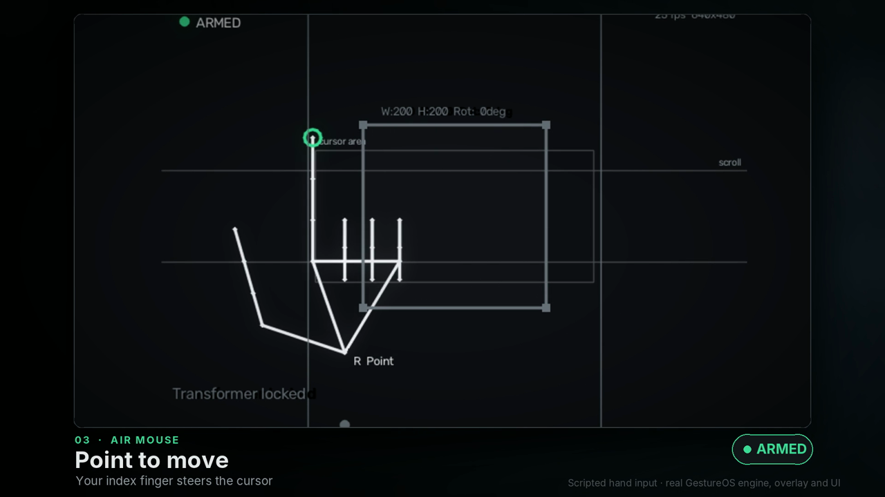](docs/media/demo.mp4)

<sub>Voice-over: Kokoro neural text-to-speech (Apache-2.0). Music: original, generated by `tools/video/music.py`. Footage: the real application driven by scripted hand landmarks, so it is repeatable; there is no webcam in it. Everything is regenerated by the scripts in `tools/video/` and `tools/capture_footage.py`.</sub>

| Disarmed: sees, sends nothing | Arming (hold both palms) |
|---|---|
| 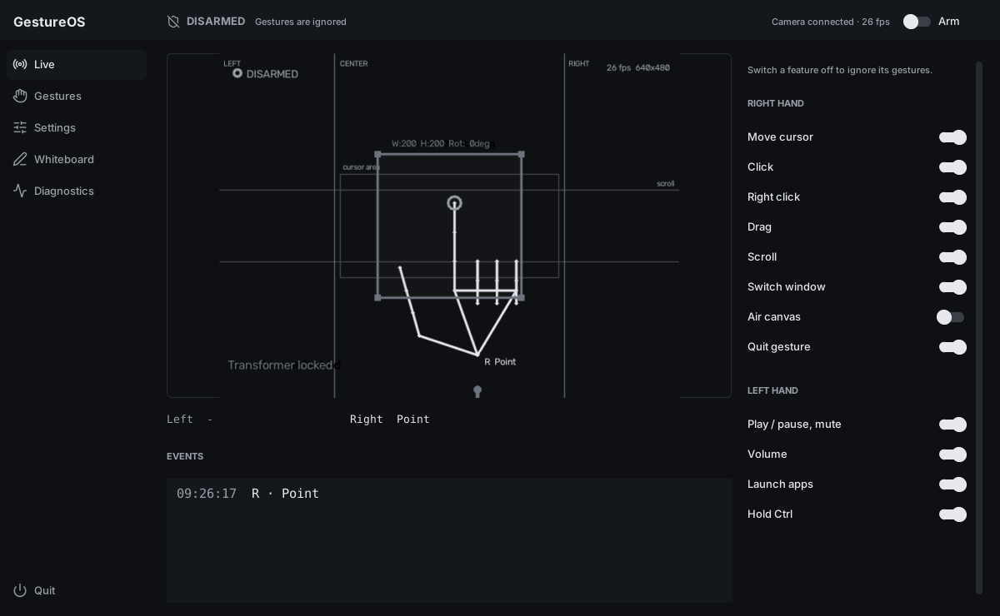 | 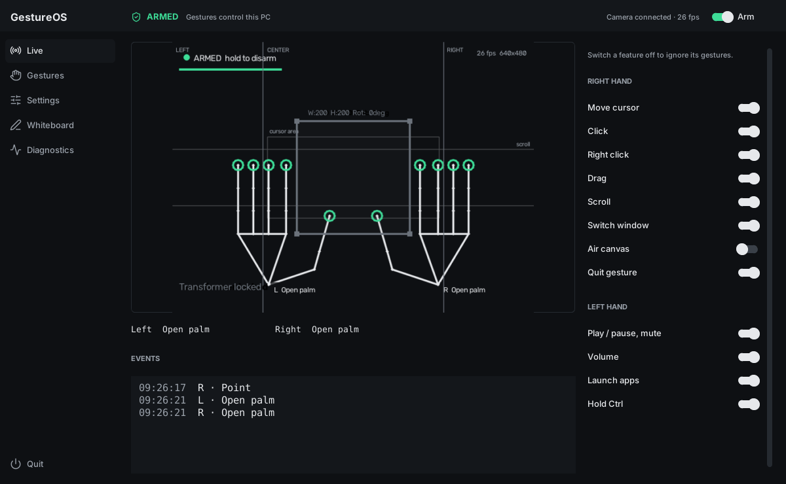 |
| **Air mouse** | **Click (thumb to middle finger)** |
| 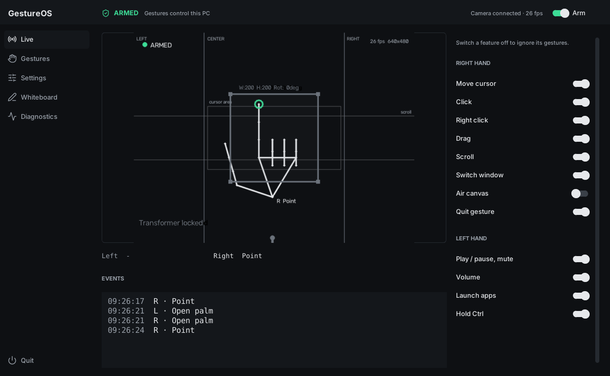 | 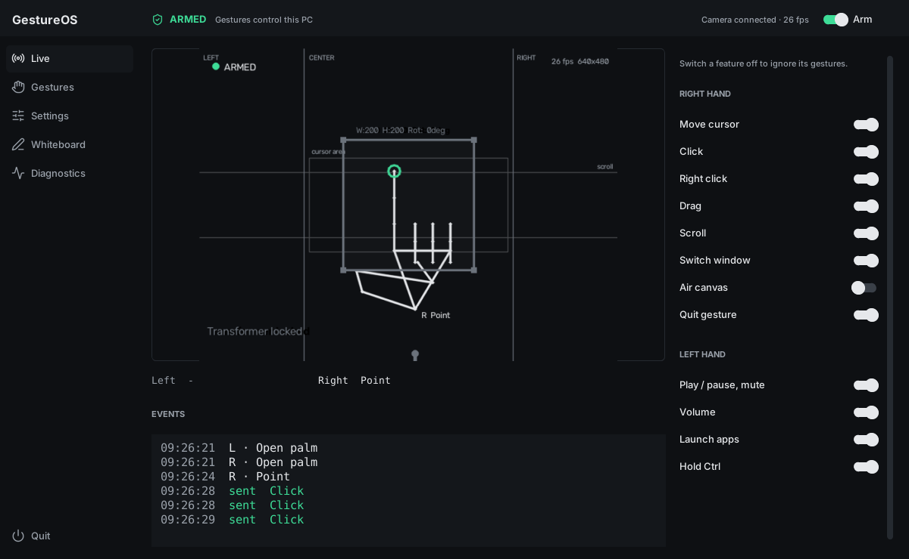 |
| **Launcher with hold-progress bar** | **Air canvas** |
| 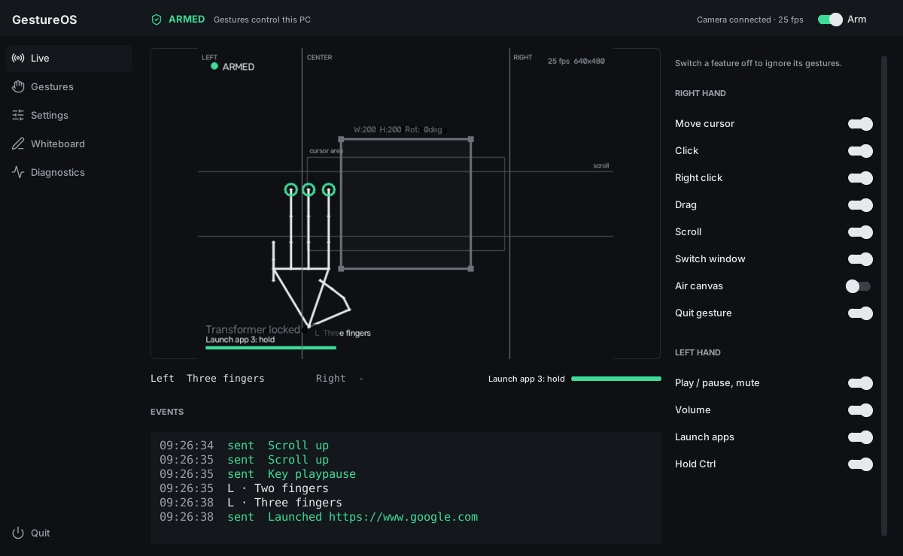 | 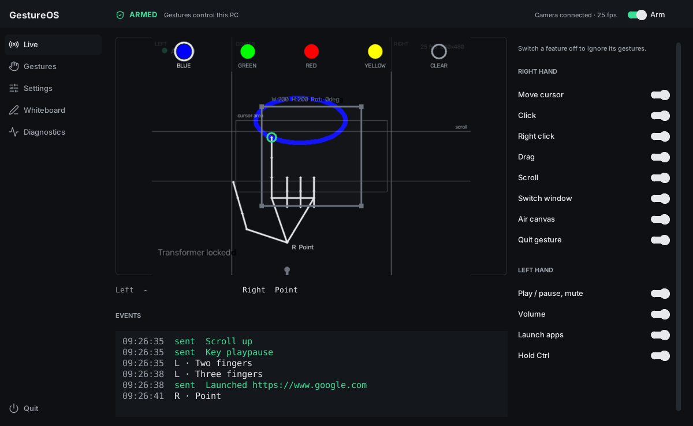 |

| Gestures cheat sheet (generated from the code) | Settings |
|---|---|
| 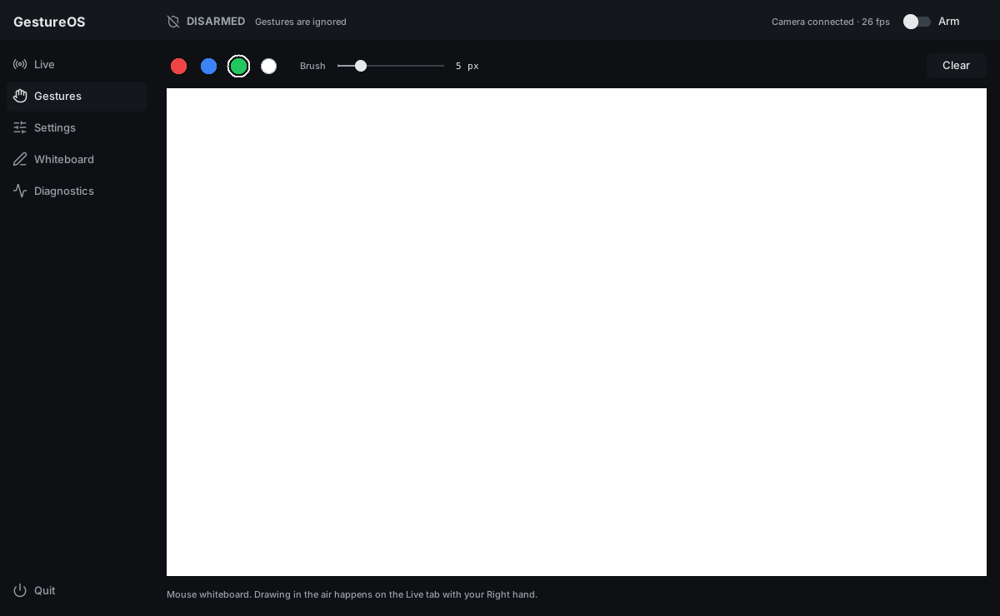 | 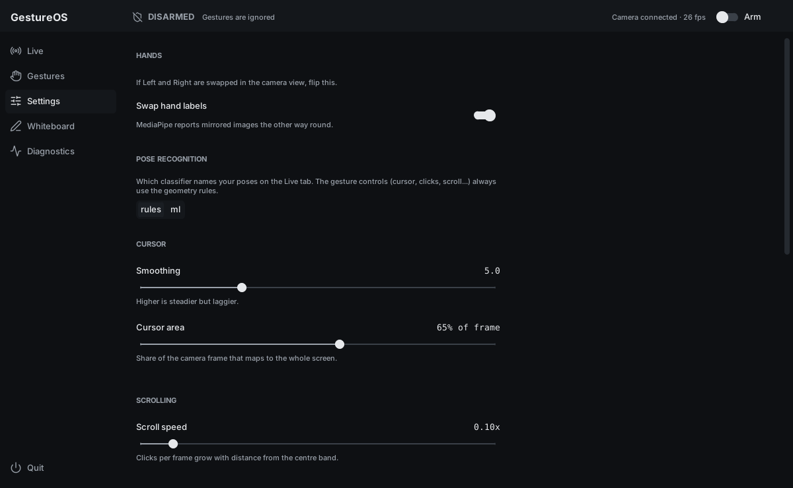 |

| Diagnostics (camera view with overlay, system meters, log) |
|---|
| 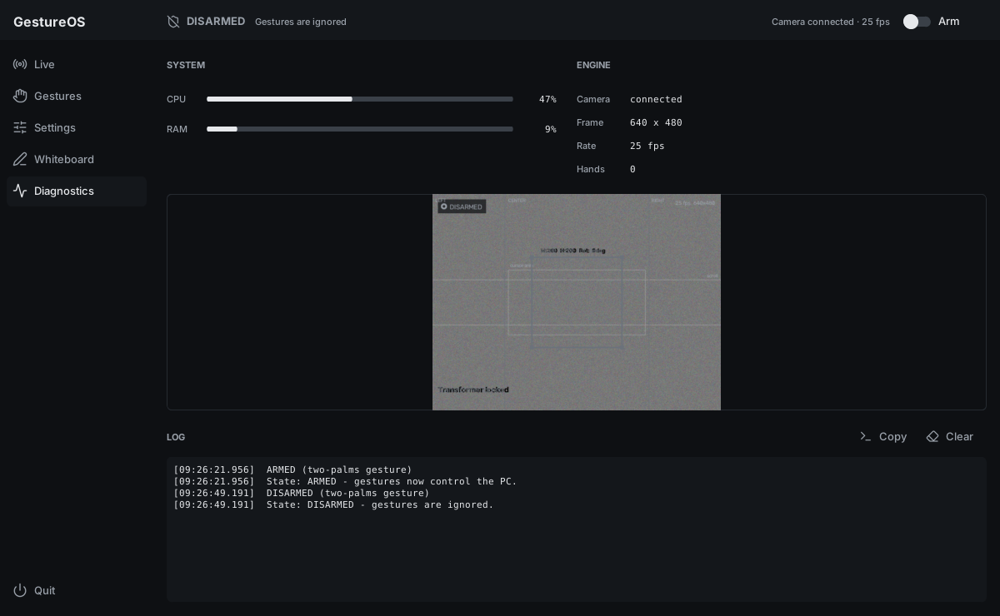 |

## What works

| Feature | Hand | Gesture (summary) |
|---|---|---|
| Air mouse (move, click, right-click, drag) | Right | Pinky curled, index up to move; thumb-middle pinch clicks, thumb-ring pinch right-clicks, thumb-index pinch held drags |
| Scroll | Right | Open palm held in the top / bottom band of the frame |
| Window switch | Right | Open palm held at the far left / right edge |
| Air canvas | Right | Index draws; index + middle hover and pick a colour in the top strip |
| Quit | Right | Thumbs up, held |
| Media and volume | Left | Peace sign play/pause, point mute, thumb-index pinch at a side zone changes volume |
| App launcher | Left | Hold 2, 3 or 4 fingers up (targets are configurable) |
| Ctrl hold | Left | Fist |
| Arm / disarm | Both | Both open palms held about a second |

The in-app **Gestures** tab shows each one with a diagram; it is generated from the controller code so it cannot drift from what the app does.

## How it works

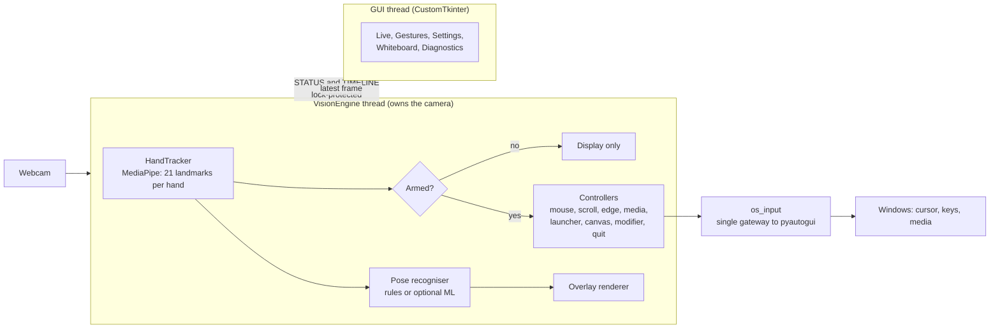

**Threads.** A vision thread owns the camera and runs the whole per-frame pipeline; the GUI thread owns Tk. They share only small, lock-protected state (`STATUS`, `TIMELINE`, a log queue) and one frame reference, and the GUI is read-only with respect to it.

**One door to the OS.** Every mouse or keyboard event goes through `core/os_input.py`. That one module checks the armed flag, clamps coordinates to the screen, remembers what is held down so it can release it on disarm, and records each action to the timeline. Feature code cannot bypass it.

**Per-frame pipeline** (`VisionEngine._process_frame`): flip the frame, detect hands, run the arm gesture, run each enabled controller (each wrapped by a fault isolator), classify poses for display, publish status, render the overlay, then publish a frame for the GUI. Per-stage timings (capture, MediaPipe, classify, controllers, overlay) are recorded for the benchmark.

**Geometry** (`core/geometry.py`) works on landmark distances scaled by hand size (wrist to middle knuckle). Finger-extended, pinch and open-palm tests therefore survive rotation and distance changes.

**Safety state machine.**

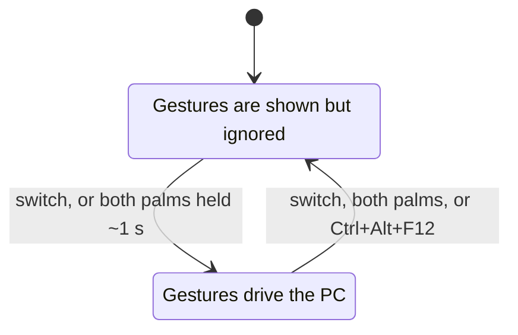

**Learned classifier (optional).** Landmarks become 50 normalised features (translated to the wrist, scaled by hand size, left hands mirrored, rotated upright). Logistic regression, random forest and a small MLP are compared leave-one-session-out against the rules on the same rows; the deployable model is numpy-only (no pickle). It only changes the *names shown* in the UI; the controllers always use the rules. No benchmark results are published until real sessions are recorded. See [docs/ML.md](docs/ML.md).

## Tech stack

| Area | Choice |
|---|---|
| Hand tracking | MediaPipe Hand Landmarker (model downloaded and SHA-256 checked on first run) |
| Video | OpenCV |
| Desktop UI | CustomTkinter, Lucide icons (ISC), Segoe UI Variable / Consolas |
| OS input | pyautogui, behind a single gateway |
| Optional ML | numpy inference; scikit-learn for training only |
| Quality | pytest (600+ tests), ruff, GitHub Actions workflow |

## Install (Windows)

Requires **Python 3.12 or newer** and a webcam.

```bash
git clone https://github.com/Dhairya233/GestureOS.git
cd GestureOS
python -m venv venv
venv\Scripts\activate
pip install -r requirements.txt
python run.py
```

On the first run, `run.py` downloads the MediaPipe hand model (about 7.8 MB) and checks its SHA-256. To fetch or verify it by hand:

```bash
python tools/download_model.py            # download if missing
python tools/download_model.py --verify   # check only
python run.py --check                     # verify Python, packages, model, config; no camera
```

Settings live in `hand_gesture_system/config.json`, created from `config.default.json` on first run. It is git-ignored.

**First use:** start the app, check the Live tab shows your skeleton, then arm it (switch in the top bar, or both palms). Keyboard: **Ctrl+1 to Ctrl+5** switch tabs, which helps when your hand is steering the cursor.

## Limitations (honest list)

- **Windows only** (media keys, `winsound`, default launcher targets). A webcam is required.
- Accuracy depends on lighting, camera angle and how clearly the hand is visible; fast motion can drop frames.
- The learned classifier has no published results yet, and there are no published latency numbers: both need recordings from a real camera.
- The demo video and screenshots here are generated from scripted landmarks, not from a webcam.
- Earlier prototype tabs (Music Studio, Gesture Games, phone-camera routing, custom shortcuts) were UI shells without an engine and were removed.

## Tests

```bash
pip install -r requirements-dev.txt
python -m pytest tests
```

These cover the safety logic, gesture geometry and controllers with fake input, plus a smoke test that builds the real window (skipped when no display is available; on a headless Linux box use `xvfb-run -a python -m pytest tests`). They cannot test the camera or real gestures; those need a person on Windows.

## Project layout

```
run.py                      entry point
tools/download_model.py     model download + checksum
tools/make_demo.py           regenerate the screenshots in docs/media
tools/capture_footage.py    record 1080p footage of the app for the film
tools/video/                voice-over, music, compositing and mixing scripts for demo.mp4
tools/render_ui.py          render every UI tab to PNG (fake camera)
tools/render_overlay.py     render the camera overlay on synthetic hands
tools/record_gestures.py    record labelled landmarks (learned classifier)
tools/train_classifier.py   train + leave-one-session-out evaluation + plots
tools/benchmark.py          per-stage latency and FPS
tests/                      pytest suite
docs/SAFETY.md              safety model
hand_gesture_system/
  main.py                   VisionEngine thread + startup
  config_manager.py         load / save settings
  config.default.json       shipped defaults
  core/                     hand tracking, geometry, arming, os_input, safety,
                            recognizer, status/timeline, overlay, design tokens
  ml/                       optional learned classifier (numpy inference), dataset, evaluation
  models/                   trained model goes here (gesture_model.npz)
  features/                 one module per gesture feature
  ui/                       CustomTkinter window
    app_window.py           GestureApp: top bar (armed state), sidebar, refresh loop
    views/                  live, gestures, settings, whiteboard, diagnostics
    theme.py, widgets.py, icons.py, diagrams.py, animator.py
    assets/icons/           Lucide icons (ISC licence included)
```

## Optional: record your own data and benchmark

```
pip install -r requirements-ml.txt
python tools/record_gestures.py --session desk_evening
python tools/train_classifier.py data/*.csv
python tools/benchmark.py --source camera
```

## License

MIT, see [LICENSE](LICENSE). Author: [Dhairya233](https://github.com/Dhairya233).
